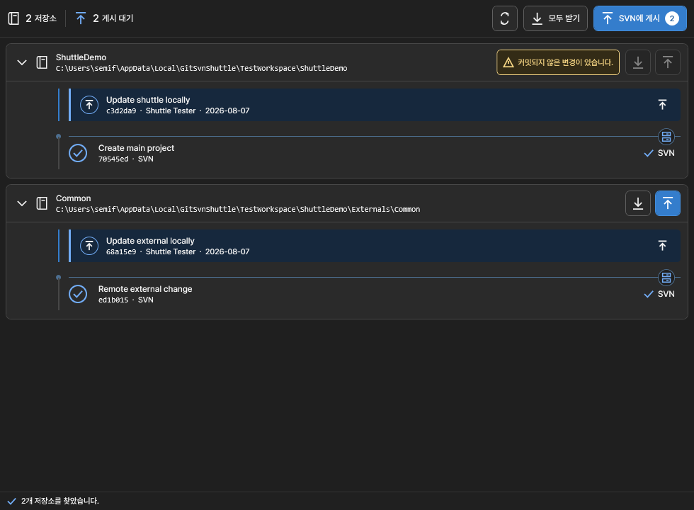

# Git-SVN Shuttle

Git-SVN Shuttle is a Visual Studio extension for teams that use Git locally while an SVN server remains the source of truth.




It fills the gap left after Visual Studio's built-in Git UI has staged and committed changes:

- **Get from SVN** runs `git svn rebase`.
- **Publish to SVN** previews local commits and runs `git svn dcommit`.
- **SVN paths and branches** manages each repository's trunk, branch, and tag tracking paths, including old and new layouts together.
- Create an SVN server branch from a specified source URL and revision, fetch it, and connect a local work branch.
- Inspect the current branch's actual dcommit destination from its SVN history and transport configuration.
- The solution root and nested Git-SVN repositories are discovered and processed sequentially.
- Loaded projects linked through directory junctions can resolve their external Git-SVN repository root without recursively scanning arbitrary junction targets.

## Current MVP

Open **Tools > Git-SVN Shuttle** in Visual Studio. The tool window shows every Git repository under the solution that contains `svn-remote.*` configuration. Select only the repositories to publish, then expand a repository row to review its pending commits in the exact order they will be sent by `git svn dcommit`.

The table keeps repository identity, current state, pending count, SVN destination, and individual actions visible. It switches to a compact two-line layout in narrow tool windows without horizontal scrolling.

Uncommitted changes to tracked files, including staged additions, are shown separately in the repository header. They are not part of the dcommit list, and that repository's receive/publish buttons remain disabled until the changes are committed or discarded. Untracked files (`??` in Git status) do not block rebase or publishing and remain outside the dcommit list.

Each repository's **SVN 연결 관리** button opens branch creation and connection settings.
The branch form fills the source and destination when they can be determined and previews the resulting SVN URL and local Git branch.
Revision, creation message, local Git name, and switching options are under **고급 설정**.
When several configured paths are possible, select the intended source and destination.

Tracking settings can be changed while local work is dirty: applying paths fetches SVN history while preserving HEAD, local commits, staging, and working files.
Retired paths retain the bindings needed by existing history, so an old local work branch continues to publish to its original SVN path.
Changing tracking paths does not move that branch to a new destination.
See [SVN paths, branches, and layout migration](docs/svn-paths-and-branches.md) for examples and migration steps.

If `git svn rebase` stops on conflicts, the repository shows the unresolved files separately. Resolve and stage them with Visual Studio's Git tools, then continue the rebase from Git-SVN Shuttle, or explicitly confirm that you want to abort it.

Before a rebase, the extension requires no uncommitted changes to tracked files and an attached branch. Before dcommit, it additionally rejects merge commits and runs `git svn dcommit --dry-run`. The confirmation records the exact HEAD, pending commit hashes, SVN baseline, and SVN configuration. Confirming revalidates that snapshot and runs dcommit only while the current branch still points to the confirmed HEAD; any mismatch aborts the operation. **Publish all** preflights every repository before publishing the first one, then stops at the first failure. SVN cannot make publishing across multiple repositories atomic, so earlier successful dcommits cannot be rolled back automatically.

Repository and Git metadata changes are monitored through debounced filesystem notifications. This keeps the UI current without periodic Git polling. While publish confirmation is open, notifications first trigger a local snapshot check: delayed or duplicate notifications keep the confirmation open when the prepared state still matches. A changed snapshot invalidates the confirmation. The snapshot validation before dcommit remains the final safety boundary even if a filesystem notification is delayed or lost.

The root repository is processed first, followed by nested repositories in path order. User-defined ordering is planned but is not part of this MVP.

## Use in Visual Studio

1. Install the VSIX from `src\GitSvnShuttle.Vsix\bin\Release\net472\GitSvnShuttle.Vsix.vsix`.
2. Open a solution located inside the main Git-SVN working copy.
3. Open **Tools > Git-SVN Shuttle**.
4. The extension checks `git --version` and `git svn --version` once. If setup is required, use the folder button to select `git.exe` or the search button to scan common locations.
5. Select the repositories to publish and expand each row to review its pending commits.
6. Use the download icon for one repository or **모두 받기** before publishing.
7. Use an upload icon to publish one repository, or publish the selected repositories in the displayed selection order. Confirm the SVN destination and exact commits before starting. If HEAD, pending commits, the SVN baseline, or SVN configuration changes, publishing stops and requires a new confirmation.
8. Select **로그 보기** in the tool window, or use **View > Output > Git-SVN Shuttle**, to read timestamped command results and failure details.
9. Use **SVN 연결 관리** on a repository row to create a branch or open **연결 설정** for tracking paths and the actual SVN destination.
   The command bar's **SVN 저장소 새 연결** action accepts an existing local folder for a new connection.
   Active operations show progress and keep **작업 취소** and **닫기** available.
   Closing the panel leaves the operation running; cancellation is a separate action.

When a loaded project is linked through a directory junction, the repository card identifies it as an external link and shows the physical Git working path used for Git-SVN operations.

While a Git-SVN command is running, use **취소** in the command bar to request cancellation.

For a reproducible local SVN and nested Git-SVN workspace, see [`test-env/README.md`](test-env/README.md).

## Requirements

- Visual Studio 2022 or 2026 on x64 Windows
- .NET Framework 4.7.2 or newer
- A working `git svn` runtime
- An existing Git-SVN checkout, or a local folder to initialize/connect through tracking settings
- For SVN server branch creation, a separate SVN command-line client available on `PATH` or through `GIT_SVN_SHUTTLE_SVN`

The extension scans `PATH`, common Git for Windows locations, and common MSYS2 UCRT64/MINGW64 locations. The runtime panel provides four actions:

- Select a `git.exe` file.
- Automatically search again.
- Recheck the currently displayed path.
- Clear the user-selected path and return to automatic discovery.

A selected path is validated with both `git --version` and `git svn --version` before it is saved. The runtime panel can be reopened from the gear button in the command bar.

For scripted or managed setup, `GIT_SVN_SHUTTLE_GIT` remains available as an advanced override:

```powershell
$env:GIT_SVN_SHUTTLE_GIT = 'C:\msys64\ucrt64\bin\git.exe'
$env:GIT_SVN_SHUTTLE_SVN = 'C:\Tools\Subversion\bin\svn.exe'
```

The configured runtime paths must be absolute. UI changes apply immediately; an externally changed environment variable requires restarting Visual Studio. Commands are non-interactive, have bounded output and time limits, and never accept credentials through this extension. Configure SVN credentials for both the selected Git-SVN runtime and the SVN command-line client before using their operations. A new connection fetches tracking refs without an initial checkout; select a fetched ref to create the first local work branch.

## Security boundaries

- Discovery skips directory junctions and other reparse-point children and stops at a finite directory limit.
- External repository resolution starts only from paths of projects loaded by Visual Studio, resolves one physical path, and does not recursively traverse arbitrary junction targets.
- Publish authorization uses an immutable snapshot and a pinned commit hash rather than only a repository path.
- SVN destinations are shown with URL credentials removed.
- Credential-shaped values are removed from Visual Studio Output logs.
- The Git executable is resolved to an absolute file path before any repository command runs.

## Build

```powershell
dotnet restore git-svn-shuttle.sln
dotnet test tests\GitSvnShuttle.Core.Tests\GitSvnShuttle.Core.Tests.csproj
dotnet build src\GitSvnShuttle.Vsix\GitSvnShuttle.Vsix.csproj -c Release -t:Rebuild
```

The VSIX is written below `src\GitSvnShuttle.Vsix\bin\Release`.

## CI and releases

GitHub Actions runs on pull requests to `main`, pushes to `main`, and version tags (`v*`). You can also run **CI** manually from the repository's **Actions** tab.

The Windows jobs run the unit tests, build the Release VSIX, and exercise real rebase and dcommit operations against a disposable local SVN server. The integration job downloads a checksum-verified Portable Git 2.51.2 runtime because newer Git for Windows releases no longer bundle `git svn`. **CI passed** succeeds only when both jobs succeed. The workflow saves the VSIX and unit-test results as downloadable artifacts.

The [tracking and branch probe](tests/GitSvnShuttle.TrackingProbe/README.md) also uses disposable local SVN repositories to check old, new, and mixed layouts, exact-revision branch copies, preserved local work, and actual dcommit destinations.

To publish a GitHub Release, update the version in `src/GitSvnShuttle.Vsix/GitSvnShuttle.Vsix.csproj` and `src/GitSvnShuttle.Vsix/source.extension.vsixmanifest`, update `RELEASE_NOTES.txt`, and push a matching tag such as `v0.4.2`. The tag, project version, and manifest version must match. After all checks pass, the workflow creates a release with generated notes and attaches the tested VSIX. Creating the release requires no additional secret; it uses GitHub's workflow token.

To update Visual Studio Marketplace, download the `vsix` artifact from a successful CI run and extract `GitSvnShuttle.Vsix.vsix`. Sign in to the [publisher management page](https://marketplace.visualstudio.com/manage/publishers), select `semisemil`, edit the existing Git-SVN Shuttle listing, and upload the new VSIX. Marketplace publication is manual and requires no publishing token in CI. GitHub Release publication remains available through version tags; it does not update Marketplace.

## Code structure

`GitSvnWorkspaceService` delegates discovery, repository reads, rebase, publishing, tracking configuration, branch creation, and destination resolution to dedicated components. The VSIX separates repository rows, publish confirmation state, operation outcomes, and Output logging from the main view model. See [the refactoring notes](docs/refactoring.md) for responsibility ownership and verification coverage.

## Privacy and license

Git-SVN Shuttle does not send telemetry or repository data to the publisher. See [PRIVACY.md](PRIVACY.md) for the exact boundary.

Git-SVN Shuttle is available under the [MIT License](LICENSE.txt).

## Deliberately out of scope

- A full `git svn clone` wizard and automatic initial checkout
- Automatic replay of existing local commits onto a different SVN path
- Advanced SVN metadata rewrite/SVM/SVNSync tracking modes and multi-star branch/tag patterns
- Merging feature branches into SVN trunk or creating deployment tags on the server
- Git commit/staging UI already provided by Visual Studio
- Installing or bundling a Git-SVN runtime
- Parallel dcommit
- Automatic rollback across SVN repositories
